  
  
  

<!-- wave -->

## 👋 About Me

Hi, I'm **Henry Khoo** — a software engineer who loves turning ideas into clean, working code. I work across the stack, from frontend interfaces to backend services, data pipelines, and cloud infrastructure, and I enjoy building things that are both useful and a little bit delightful.

- 🔭 I'm currently working on **web applications and AI-powered tooling**
- 🧠 Comfortable across the **full stack** — from UI to APIs to the infrastructure underneath
- 💬 Ask me about **JavaScript, React, Python, or building with LLMs**

<!-- wave -->

## 🛠️ Tech Stack

  
  
  
  
  
  
  
   
  
  
  
  
  
  

<!-- wave -->

## 📊 GitHub Stats

  
  

  

<!-- wave -->

  

